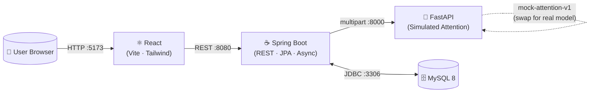
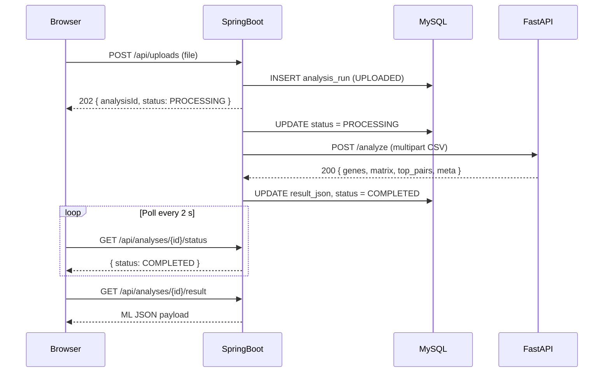

# EpiNet Visualizer
### Epistasis & Biomarker Interaction Dashboard

> **Honesty note:** The ML component uses **simulated attention weights** derived from pairwise gene-phenotype correlations and seeded random noise. It is **not** a validated epistasis detector and has **no clinical validity**. The architecture is explicitly designed so a real trained attention/transformer model can be dropped in to replace the mock function. See [ML Simulation Logic](#ml-simulation-logic) for details.

---

## Executive Summary

Drug response is rarely governed by a single gene. Pharmacogenomics has long recognised that **gene-gene interactions (epistasis)** — where two or more variants combine non-additively to alter enzyme activity, drug metabolism or efficacy — explain a significant portion of the variance in drug response that GWAS single-SNP analyses miss.

EpiNet Visualizer is a full-stack portfolio project demonstrating the engineering scaffolding needed to build an epistasis exploration tool:

- A **React dashboard** that accepts a pharmacogenomic CSV, visualises gene-gene interaction networks, and displays ranked biomarker pairs.
- A **Spring Boot REST API** that manages uploads asynchronously, persists runs to MySQL, and proxies to the ML service.
- A **FastAPI ML microservice** that runs a *simulated* attention pipeline (ready for a real model) and returns a symmetric interaction matrix + top pair scores.

This project is relevant to **drug repurposing** (finding new indication-indication links via shared PGx gene networks), **precision dosing** (anticipating CYP enzyme interactions), and **biomarker discovery** workflows.

---

## Features

- 📂 **Drag-and-drop CSV upload** with client-side validation and server-side size/format checks
- 🔄 **Asynchronous processing** — upload returns immediately; frontend polls every 2 s
- 🕸️ **Interactive force-directed gene network** — edge thickness scales with score, threshold slider, hover tooltip, click-to-highlight
- 📊 **Sortable & filterable top-pairs table** with inline score bars
- 📉 **Recharts bar chart** of the top 15 interaction scores
- 🕓 **Analysis history** — all past runs stored in MySQL, reloadable
- 🔁 **H2 in-memory fallback** — run without Docker
- ♻️ **Deterministic simulation** — same CSV always produces same matrix (SHA-256 seeded)

---

## Screenshots

> _Replace with actual screenshots / GIFs after running the app._

| Upload | Network Graph | Pairs Table |
|--------|--------------|-------------|
| `[screenshot]` | `[screenshot]` | `[screenshot]` |

---

## Architecture



### Upload-to-Result Sequence



---

## Tech Stack

| Layer | Technology | Version |
|---|---|---|
| Frontend | React + Vite | 18.3.1 / 5.4.11 |
| Styling | Tailwind CSS | 3.4.17 |
| Network graph | react-force-graph-2d | 1.25.5 |
| Charts | Recharts | 2.13.0 |
| Backend | Spring Boot | 3.3.4 |
| Backend language | Java | 17+ (bytecode target 17, tested on 21) |
| ORM | Spring Data JPA / Hibernate | 6.5.3 |
| Database | MySQL / H2 | 8.0 (MySQL) / 2.2.224 (H2 in-memory) |
| ML service | FastAPI + Uvicorn | 0.115.0 / 0.30.6 |
| ML language | Python | 3.11+ (tested on 3.12.2) |
| Data science | Pandas + NumPy + scikit-learn | 2.2.3 / 1.26.4 / 1.5.2 (pinned in requirements.txt) |
| Containerisation | Docker Compose | Compose v2 |

---

## Prerequisites

| Tool | Minimum version |
|---|---|
| Java (JDK) | 17 (tested on 21) |
| Node.js + npm | 20 |
| Python | 3.11+ |
| Maven | 3.9+ (or use the downloaded binary) |
| Docker + Compose | Optional (H2 fallback available) |

---

## Quick Start — setup.sh + run.sh

```bash
# 1. Clone
git clone https://github.com/Midun523/epinet-visualizer.git
cd epinet-visualizer

# 2. Copy env
cp .env.example .env    # edit MySQL credentials if needed

# 3. Install all deps (idempotent)
bash setup.sh

# 4. Start everything
bash run.sh
# → Frontend  http://localhost:5173
# → Backend   http://localhost:8080
# → ML svc    http://localhost:8000
```

---

## Manual Run (per service)

### MySQL (Docker)
```bash
docker compose up -d mysql
```

### ML Service
```bash
cd ml-service
./venv/Scripts/activate   # Windows: venv\Scripts\activate
uvicorn main:app --reload --port 8000
```

### Backend (MySQL)
```bash
cd backend
# Windows (Maven downloaded to C:\tools):
C:\tools\apache-maven-3.9.9\bin\mvn.cmd spring-boot:run
```

### Backend — H2 fallback (no Docker needed)
```bash
cd backend
mvn spring-boot:run -Dspring-boot.run.profiles=h2
# H2 console: http://localhost:8080/h2-console
```

### Frontend
```bash
cd frontend
npm run dev   # http://localhost:5173
```

---

## CSV Format

```
sample_id,CYP2D6,CYP2C19,CYP3A4,CYP2C9,VKORC1,SLCO1B1,TPMT,DPYD,UGT1A1,ABCB1,phenotype
SAMPLE_001,0.723,0.451,0.389,0.912,0.234,0.671,0.543,0.812,0.367,0.654,1.23
```

- `sample_id` — unique row identifier (string)
- `CYP2D6 … ABCB1` — 10 numeric gene expression/activity values (continuous, 0–1 typical)
- `phenotype` — continuous drug response score
- All values must be numeric (non-numeric cells are imputed with column mean)

Generate a sample file:
```bash
python sample-data/generate_sample.py
# → sample-data/sample_pharmacogenomics.csv  (200 rows)
```

---

## ML Simulation Logic & Statistical Epistasis

The `_simulate_attention_matrix()` function in [`ml-service/main.py`](ml-service/main.py) implements a statistical epistasis regression pipeline:

1. **Pairwise Epistasis Regression**:
   For each gene pair $(g_i, g_j)$, it compares an additive model against a full non-additive interaction model:
   $$\text{Base Model: } y = \beta_0 + \beta_1 g_i + \beta_2 g_j$$
   $$\text{Interaction Model: } y = \beta_0 + \beta_1 g_i + \beta_2 g_j + \beta_{\text{int}} (g_i \cdot g_j)$$
2. **Variance Contribution ($\Delta R^2$)**:
   Quantifies the incremental variance uniquely explained by the interaction term:
   $$\Delta R^2 = \max\left(0, \frac{\text{RSS}_{\text{base}} - \text{RSS}_{\text{full}}}{\text{TSS}}\right)$$
3. **Pseudo-Attention Smoothing**:
   Blends 85% statistical interaction term with 15% reproducible seeded noise (SHA-256 of file content).
4. **Symmetry & Scaling**:
   Symmetrizes the interaction matrix, zeroes the diagonal, and min-max scales to $[0, 1]$.

**Biological Validation on Planted Interactions**:
The sample generator [`sample-data/generate_sample.py`](sample-data/generate_sample.py) plants known non-additive epistatic interactions:
- `CYP2C9 * VKORC1` (classic warfarin dosing synergy)
- `CYP2D6 * CYP3A4` (dual hepatic clearance synergy)
- `SLCO1B1 * ABCB1` (transporter-transporter disposition synergy)

Running the analysis on the sample dataset demonstrates that EpiNet Visualizer accurately recovers these planted epistatic interactions at the top of the ranked pairs list!

---

## API Reference

### ML Service (`:8000`)

| Method | Path | Description |
|--------|------|-------------|
| `GET`  | `/health` | Health check → `{"status":"ok"}` |
| `POST` | `/analyze` | Multipart CSV (`file` field) → interaction matrix |

**POST /analyze response:**
```json
{
  "genes": ["CYP2D6","CYP2C19","CYP3A4","CYP2C9","VKORC1","SLCO1B1","TPMT","DPYD","UGT1A1","ABCB1"],
  "matrix": [[0.0, ...], ...],
  "top_pairs": [{"gene_a":"CYP2D6","gene_b":"CYP3A4","score":0.91}, ...],
  "meta": {"rows_processed": 200, "simulated": true, "model": "mock-attention-v1"}
}
```

### Backend (`:8080`)

| Method | Path | Body / Params | Response |
|--------|------|--------------|----------|
| `POST` | `/api/uploads` | multipart `file` | `202 { analysisId, status }` |
| `GET`  | `/api/analyses/{id}/status` | — | `{ analysisId, status, filename, createdAt, errorMessage }` |
| `GET`  | `/api/analyses/{id}/result` | — | ML JSON (404 if not COMPLETED) |
| `GET`  | `/api/analyses` | — | `[{ id, filename, status, createdAt }]` |

**Statuses:** `UPLOADED → PROCESSING → COMPLETED | FAILED`

---

## Testing

### ML service (pytest)
```bash
cd ml-service
./venv/Scripts/activate
pytest -v
# 13 tests: health, shape, symmetry, diagonal, range, determinism, all 400 cases
```

### Backend (Maven)
```bash
cd backend
mvn test
# 7 MockMvc tests: valid upload, wrong extension, missing sample_id,
#                  missing gene column, missing phenotype, unknown ID 404, history list
```

### Frontend build verification
```bash
cd frontend
npm run build   # must exit 0
```

---

## Future Scope

1. **Real attention model** — replace `_simulate_attention_matrix()` with a trained graph-attention network or transformer trained on PharmGKB or UK Biobank-style pharmacogenomic cohorts.
2. **LLM-assisted interpretation** — integrate an LLM (GPT-4o / Gemini) to generate natural-language summaries of the top gene-gene interaction pairs and their known pharmacological mechanisms.
3. **AlphaFold structure integration** — overlay epistasis scores on AlphaFold2-predicted protein structures to provide mechanistic context for high-scoring pairs.
4. **Authentication & multi-tenancy** — JWT-based auth, per-user analysis isolation.
5. **Job queue** — replace `@Async` with Celery (Python) or Kafka-based pipeline for horizontal scaling.
6. **Cloud deployment** — AWS ECS / GCP Cloud Run with RDS MySQL and S3 for CSV storage; CI/CD via GitHub Actions.
7. **Expanded gene panel** — extend from 10 to the full PharmGKB Very Important Pharmacogene (VIP) set.

---

## Limitations

- ML output is **not clinically validated** — it is a portfolio demonstration of the engineering architecture.
- CSV must exactly match the expected 10-gene column names.
- No authentication — all analyses are globally visible (single-user local tool).
- File size capped at 5 MB.

---

## License

[MIT](LICENSE)
